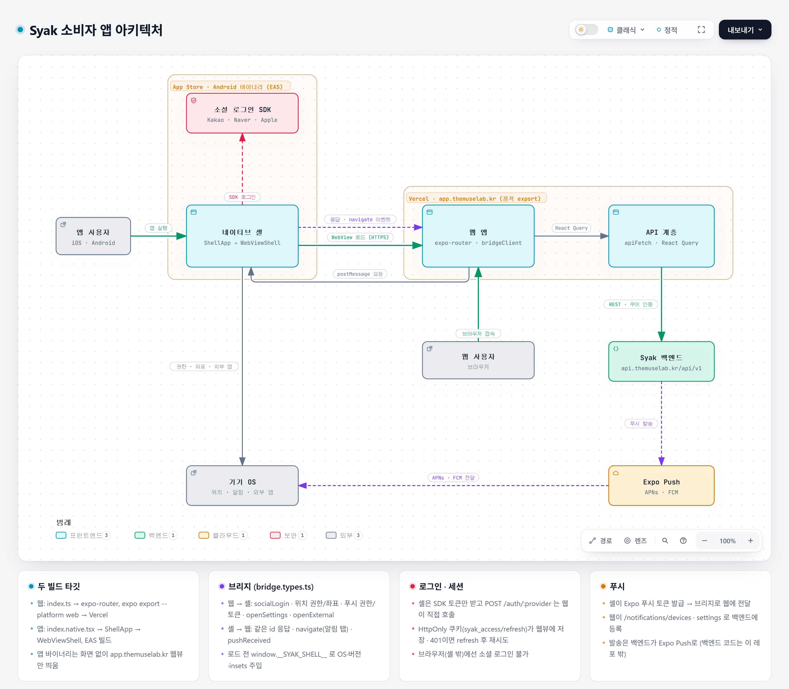

# 샥(SYAK) 소비자 앱

지금 예약되는 동네 뷰티샵의 빈자리를 지도에서 찾고 알림을 받는 앱. 한 코드베이스(Expo)로 웹(app.themuselab.kr)과 iOS·Android 앱(웹뷰 셸)을 만든다.

## 아키텍처

인터랙티브 버전(노드별 소스 링크·확대·테마): [docs/diagrams/architecture.html](docs/diagrams/architecture.html) — 받아서 브라우저로 연다.

- **한 코드베이스, 두 빌드**: 웹은 `index.ts` → expo-router 화면을 정적 export해 Vercel에 배포하고, 앱은 `index.native.tsx` → `ShellApp` → `WebViewShell`이 그 웹을 웹뷰로 띄운다.
- **브리지**: 웹이 `bridgeClient`로 소셜 로그인·위치·푸시 권한/토큰·외부 앱 열기를 셸에 요청하고, 알림 탭은 셸이 `navigate` 이벤트로 넘긴다.
- **데이터·세션**: 웹이 `apiFetch` + React Query로 백엔드(`api.themuselab.kr/api/v1`)를 HttpOnly 쿠키로 호출한다.
- **푸시**: 셸이 Expo 푸시 토큰을 발급 → 웹이 백엔드에 등록 → 백엔드가 Expo Push로 발송.

## 문서

- 개발 규칙: [CLAUDE.md](CLAUDE.md)
- 기능 명세·결정·트러블슈팅: [docs/](docs/README.md)
- 웹뷰 셸 구조: [docs/webview-migration.md](docs/webview-migration.md)
